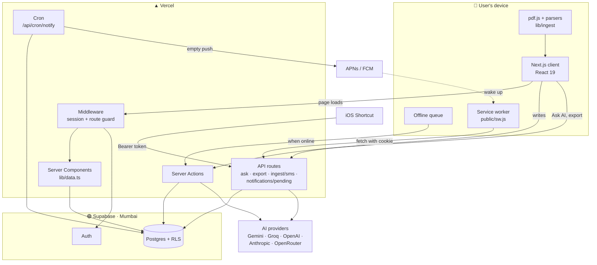
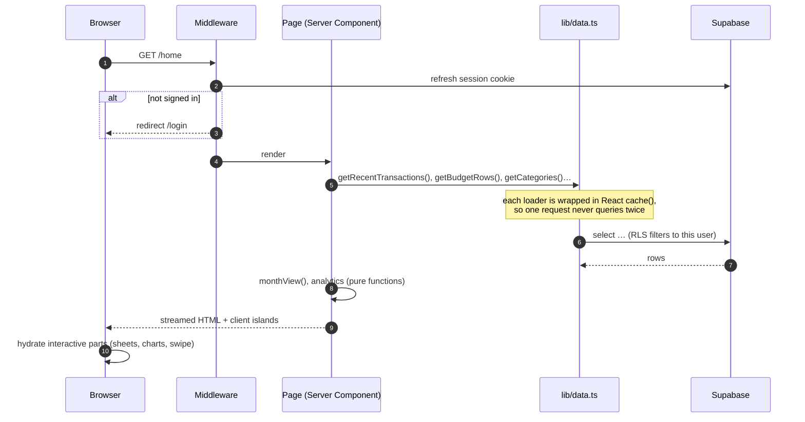
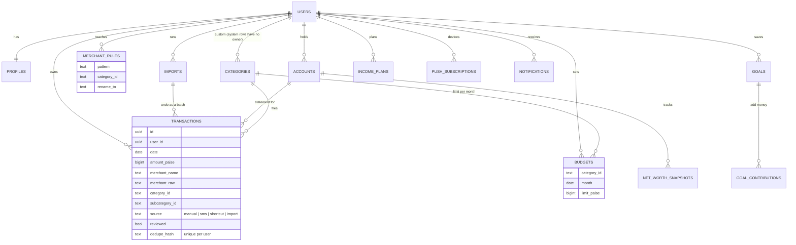
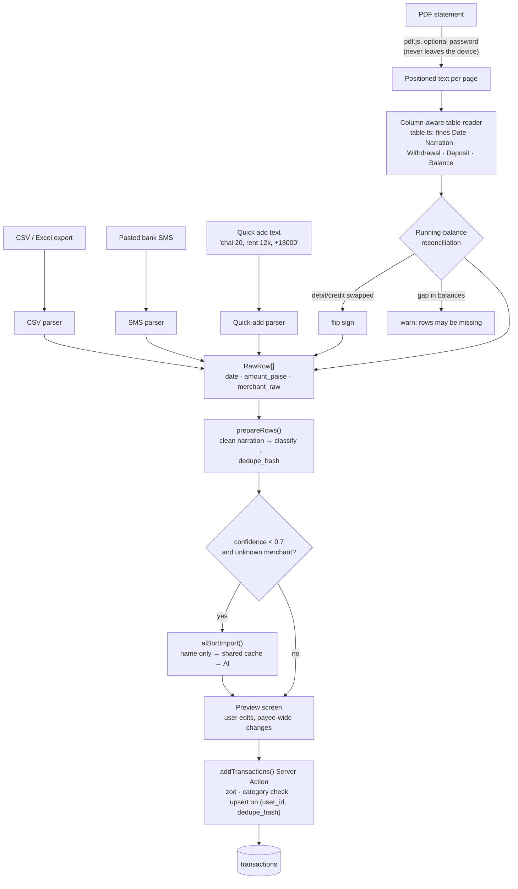
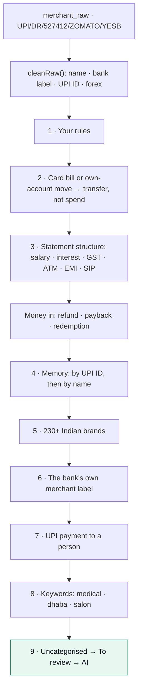
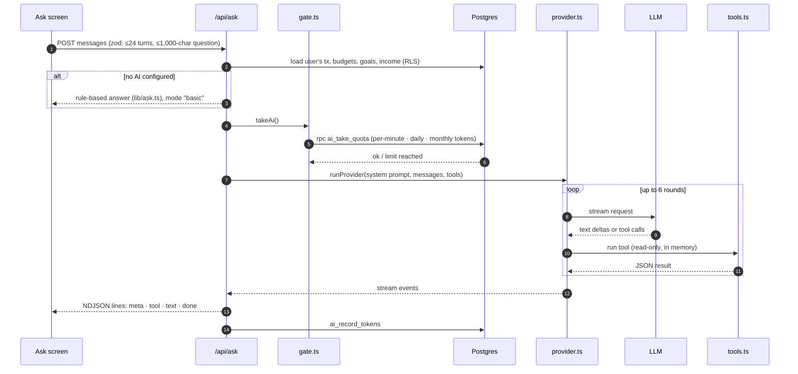
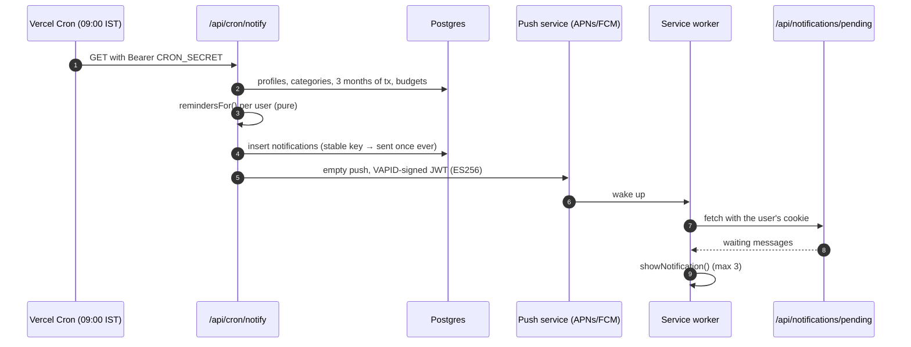
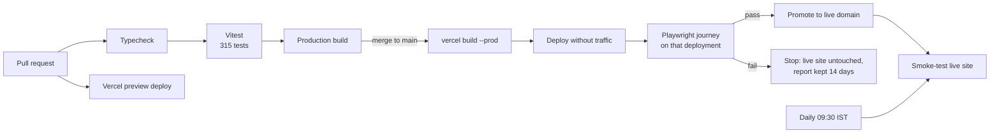

<div align="center">

# Expensly

### Know what's safe to spend today.

A personal budget app built for how India actually pays: UPI, credit cards, CRED, Swiggy at midnight, and an auto every morning.
Bring in a statement, and Expensly sorts every rupee, tells you what you can spend per day, and warns you before you run out.

**[Open Expensly →](https://expensly-tracker.vercel.app)** · Free · Works on iPhone, Android and desktop · No bank login needed

</div>

---

## Contents

**Part 1: Product**
- [Why Expensly](#why-expensly)
- [What you get](#what-you-get)
- [Getting started](#getting-started)
- [A quick tour](#a-quick-tour)
- [Bringing in your spending](#bringing-in-your-spending)
- [Privacy](#privacy)

**Part 2: Under the hood**
- [Tech stack](#tech-stack)
- [System architecture](#system-architecture)
- [How a page loads](#how-a-page-loads)
- [Data model](#data-model)
- [Ingestion pipeline](#ingestion-pipeline)
- [The categoriser](#the-categoriser)
- [The money maths](#the-money-maths)
- [AI architecture](#ai-architecture)
- [Reminders and Web Push](#reminders-and-web-push)
- [PWA and offline](#pwa-and-offline)
- [Security model](#security-model)
- [Testing, CI and deployment](#testing-ci-and-deployment)
- [Project structure](#project-structure)
- [Running it locally](#running-it-locally)

---

# Part 1: Product

## Why Expensly

Most budget apps were built for a different country. They want you to link your bank, they don't recognise `UPI/DR/527412/ZOMATO/YESB`, and they count your credit card bill as spending twice.

Expensly starts from one question you can act on every day: **how much can I safely spend today?** Budgets, insights, reminders and the AI all exist to make that number accurate.

- **Made for Indian money.** 230+ Indian brands and payment patterns, from Zepto and Rapido to IRCTC, LIC and SIPs. It reads UPI narrations, CRED bill payments, GST on card charges and Indian statement formats.
- **No bank login, ever.** You import the statement you already get. Expensly never asks for net-banking passwords, card numbers or UPI PINs.
- **Spending you can trust.** Refunds come off what you spent. Card bill payments and transfers between your own accounts aren't counted twice. A friend paying you back reduces what you "sent to people" instead of looking like income.
- **Answers, not just charts.** Ask "where can I cut back?" and get an answer from your own transactions.

## What you get

| | |
|---|---|
| 🎯 **Safe to spend today** | A daily allowance that accounts for your budget, what you've spent and the bills still to come |
| 📥 **Import anything** | Bank and card statements (PDF, including password-protected, or CSV), pasted bank SMS, or a quick typed list |
| 🧠 **Automatic sorting** | 21 categories and 80+ subcategories, filled in for you, learning from every correction |
| 📊 **Budgets** | Per-category limits with a pace marker, your own categories, or one tap to have AI suggest them |
| 💡 **Insights** | A money health score, needs vs wants vs savings, recurring bills, unusual charges and avoidable fees |
| 📅 **Daily calendar** | Every day of the month coloured by how much you spent |
| ✦ **Ask AI** | Chat with your own money: "Why did I spend more than last month?" |
| 🔔 **Reminders** | Budget warnings, bills due tomorrow and a Monday summary, as phone notifications |
| 🏦 **Goals & net worth** | Accounts, net worth over time and savings goals |
| 🔒 **Your data, your call** | Export everything any time; delete your account in one step |

## Getting started

1. **Create an account** at **[expensly-tracker.vercel.app](https://expensly-tracker.vercel.app)** with an email and password. There's no confirmation email to wait for.
2. **Install it** (recommended). On iPhone, open it in Safari → **Share** → **Add to Home Screen**. On Android, open it in Chrome → **Install app**. On desktop it has a full layout with a sidebar and a command palette (**⌘K / Ctrl K**).
3. **Follow the setup checklist** on Home: import last month's statement, add your monthly income, set budgets (or tap **Plan with AI**), and turn on reminders.

Just looking? Choose **Explore with sample data** on the welcome screen.

## A quick tour

The same four places exist on phone and desktop: **Home**, **Activity**, **Plan** and **Insights**.

- **Home** leads with the *Safe to spend today* gauge (tap to switch to *Left this month* or *Month-end forecast*), then an AI morning brief, top insights, money in vs out, a daily spending calendar and six months of cash flow.
- **Activity** lists every transaction by day. Search the way you think (`swiggy >300`, `is:refund`, `october`). Swipe right to approve, swipe left to delete, tap to edit. Change one payee's category and Expensly offers to move the rest and remember it.
- **Plan** holds **Budgets** (a bar per category with a pace marker, your own categories, AI-suggested limits) and **Goals & net worth**.
- **Insights** has the 0–100 money health score with what would raise it, your income plan, 50/30/20 split, detected subscriptions and bills, unusual charges, top merchants and spending rhythm.
- **Ask AI** (✦) answers questions from your real data, with charts and follow-up suggestions.

## Bringing in your spending

You can mix all three. **Duplicates are caught automatically**, so overlapping statements never double-count.

- **Statements (recommended).** Tap **＋ → Statement** and pick a PDF or CSV. Password-protected PDFs work: the password is used only on your device. Expensly finds the statement's columns, checks every row against the running balance ("✓ Balances add up on all 165 rows"), and shows a preview before anything is saved.
- **Bank SMS.** Paste one or more UPI or card alerts. On iPhone a Shortcut can forward them automatically.
- **Quick add.** Type it the way you'd text a friend: `chai 20, auto 60, swiggy 340, rent 12k, +18000 freelance`.

## Privacy

- **Statements never leave your device.** Files are read in the browser; only the transactions you choose to add are saved.
- **Your rows are yours.** Data lives in Supabase's Mumbai region behind row-level security, so only your login can read it.
- **AI sees only what it needs.** Merchant sorting sends only the business name: no amounts, dates or identity.
- **Notifications carry nothing personal.** Apple and Google only see an empty "wake up" signal.
- **No ads, no selling data.** Export a CSV or a full JSON copy any time, or delete your account and every row instantly.

---

# Part 2: Under the hood

## Tech stack

| Layer | Choice | Why |
|---|---|---|
| Framework | **Next.js 15** (App Router), **React 19**, TypeScript | Server Components for data-heavy pages, Server Actions for writes, one deployable |
| Database & auth | **Supabase** (Postgres, Auth, row-level security) | Per-user isolation enforced in the database, not the app |
| Hosting | **Vercel** (Node.js functions, Cron) | Preview deploys per PR, a daily cron for reminders |
| Styling | Hand-written CSS with design tokens (`app/globals.css`) | One dark-first design system, light mode follows the phone |
| PDF parsing | **pdf.js** (`pdfjs-dist`), in the browser | Statements and their passwords never reach the server |
| Validation | **zod** | Every Server Action and API body is parsed before use |
| AI | Plain `fetch` clients for Anthropic and OpenAI-compatible APIs | No SDKs; Gemini, Groq, OpenAI and OpenRouter all work through one abstraction |
| Push | Web Push with VAPID, implemented with `node:crypto` | No push library, no payload encryption needed |
| 3D | **three.js** (lazy-loaded) | The optional 3D calendar and login orb |
| Tests | **Vitest** (unit), **Playwright** (end-to-end) | 315 unit tests, plus a signed-in journey before every release |

## System architecture



Three rules shape the whole design:

1. **Parse on the device, store on the server.** Statements are turned into rows in the browser; the server only ever sees the rows the user approves.
2. **The database is the security boundary.** Every user-owned table has row-level security keyed on `auth.uid()`, so a bug in a query can't leak another user's rows.
3. **Pure core, thin edges.** Parsing, categorising, money maths, analytics and reminders are pure TypeScript functions with no I/O, which is why most of them are unit-tested directly.

## How a page loads



Writes go through **Server Actions** (`app/actions.ts`, `ai-actions.ts`, `notify-actions.ts`). Each one validates its input with zod, runs as the signed-in user so RLS applies, and calls `revalidatePath` so the next render shows fresh data.

## Data model

Money is stored as **integer paise** (`amount_paise`, negative = money out) and dates as `YYYY-MM-DD` in **Asia/Kolkata**, so there are no floating-point or timezone surprises.



Supporting tables: `ai_usage`, `ai_limits` and `ai_connections` (quotas and encrypted own-keys), `ai_briefs` (one cached morning brief per day), `merchant_ai_cache` (shared business-name → category answers), `app_errors` and `events` (private observability). Notable database functions:

| Function | Job |
|---|---|
| `handle_new_user` | Trigger that creates a profile on sign-up |
| `ai_take_quota`, `ai_record_tokens` | Atomic per-minute, daily and monthly AI limits (`SECURITY DEFINER`) |
| `tx_months` | Months that have transactions, for Activity's month picker |
| `uncat_needs_review` | Keeps uncategorised rows in *To review* until they get a category |
| `limit_own_categories` | Caps custom categories at 30 per user |

Migrations live in `supabase/migrations/` (`0001` → `0018`) and are applied in order.

## Ingestion pipeline

Everything in `lib/ingest/` is pure TypeScript that runs **in the browser**. The server receives finished rows.



- **Deduplication.** Each row gets a `dedupe_hash` from its date, amount and normalised merchant name (two identical spends in one batch get `#1`, `#2` so both survive). The insert is an upsert with `ignoreDuplicates` on `(user_id, dedupe_hash)`, so re-importing an overlapping statement adds only the new rows, and the result reports how many were skipped.
- **Undo.** Every import creates an `imports` row, and its transactions point at it, so a whole import can be removed in one step.
- **Accounts.** A statement can be linked to an account; its closing balance updates that account's balance.
- **SMS forwarding.** `POST /api/ingest/sms` accepts a bank SMS from an iOS Shortcut with a per-user `Bearer kosh_…` token that can only add transactions. It is rate-limited to 60 messages a minute and rows land unreviewed.

## The categoriser

`classify()` in `lib/ingest/classify.ts` runs these layers in order and stops at the first match. Each layer returns a category, subcategory, a **confidence** and a human-readable **reason** that the app shows when you tap a transaction.



- **Below 0.7 confidence** (`REVIEW_THRESHOLD`) a row lands in *To review*.
- **Memory** is built from the user's own past filings. Keying by UPI ID (`naturals.blr@ybl`) means a payee is recognised even when the bank shortens its name differently.
- **Corrections teach.** Re-filing a transaction can create a `merchant_rules` row, which wins over every other layer from then on. **Re-categorise everything** re-runs the latest classifier over history without overriding the user's own choices.
- **The AI fallback** sends only the business name, never amounts or dates, and skips anything that looks like a person's name. Answers are stored in the shared `merchant_ai_cache`, so a given shop is looked up once across all users.

## The money maths

`lib/finance.ts` turns a month of transactions into the numbers on Home. The headline is:

```
safe per day = max(0, ⌊ (budget total − spent so far − upcoming bills) ÷ days left including today ⌋)
```

| Term | Where it comes from |
|---|---|
| **budget total** | Each category's limit for this month, carried forward from the last month it was set (`resolveBudgets`) |
| **spent** | Money out minus refunds, excluding transfers, card bill payments and investments |
| **upcoming bills** | Recurring payments (`detectRecurring`) not yet paid this month and due later in it |
| **pace** | `day ÷ days in month`; the marker on every budget bar |
| **projected** | Fixed costs + upcoming bills + (variable spend ÷ day) × days in month |

`lib/analytics.ts` builds Insights from the same inputs (health score, 50/30/20 split, alerts, top merchants, weekday rhythm), and `lib/reminders.ts` reuses them to decide what to notify.

## AI architecture



- **Providers.** `lib/ai/claude.ts` (Anthropic Messages API) and `lib/ai/openai.ts` (any OpenAI-compatible API: Gemini, Groq, OpenAI, OpenRouter) are small `fetch`-based streaming clients with a tool loop. Only each provider's cheapest model tier is ever used (`CHEAP_MODELS`).
- **Failover.** The first configured key is the main provider and the second is the backup. If the main one is rate-limited or down, the request is retried on the backup automatically.
- **Seven read-only tools** compute answers from data already loaded for the request: `get_overview`, `query_transactions`, `spending_summary`, `get_recurring`, `get_budgets`, `get_alerts_and_patterns`, `get_accounts_and_goals`. The model never gets database access and can't change anything.
- **Charts in answers.** The model can emit one fenced `chart` block with JSON data from tool results; the client renders it as a bar or line chart.
- **Limits** are enforced in Postgres by `ai_take_quota`, so they can't be bypassed from the browser. Defaults: 10 questions a day, 5 a minute and 1.5M tokens a month on the app's key; people can connect their own key (stored AES-256-GCM encrypted) for higher caps.
- **Other AI features** go through the same gate: the morning brief (cached per day in `ai_briefs`), Plan with AI for budgets, Sort with AI for unclear transactions, and merchant sorting during import.

## Reminders and Web Push



- **Stable keys** such as `budget80:food:2026-10-01` or `bill:<payee>:<date>` mean each reminder fires once, on the first day its condition is true.
- **Empty pushes** need no payload encryption and carry nothing personal; the device fetches the text itself over an authenticated request.
- The same job deletes end-to-end test accounts older than two hours and sends the owner a notification summarising the last day's errors from `app_errors`.

## PWA and offline

- **Installable** via `app/manifest.ts`, with icons and a standalone display mode.
- **Service worker** (`public/sw.js`): build files are cached first (their names carry a content hash in production), main tabs are kept as their last-seen copy for offline viewing, and an `/offline` page covers the rest. Signing out clears the saved pages. In development the worker is registered as `/sw.js?dev` and never caches build files, because `next dev` reuses file names between builds.
- **Offline quick-add** (`lib/offline-queue.ts`): hand-typed entries made without a connection wait in `localStorage` (up to 200) and are sent when the phone is back online. Imports always need the server.

## Security model

| Concern | Measure |
|---|---|
| Data isolation | RLS on every user table; `user_id` defaults to `auth.uid()`; RLS policies use `(select auth.uid())` so the check runs once per query |
| Input | zod on every Server Action and API body; category IDs are checked to be built-in or the user's own |
| Secrets | Service role, AI and VAPID private keys are server-only (`import "server-only"`), never `NEXT_PUBLIC_` |
| Own AI keys | AES-256-GCM, key derived from a server secret |
| Statements | Parsed in the browser; files and PDF passwords never sent |
| SMS endpoint | Scoped per-user token that can only insert, rate-limited |
| Cron | `Authorization: Bearer CRON_SECRET` required |
| Trigger functions | Locked out of the public API (`0016_lock_trigger_functions.sql`) |
| Headers | `X-Content-Type-Options`, `Referrer-Policy`, `X-Frame-Options: DENY`, restrictive `Permissions-Policy` |
| Observability | `instrumentation.ts` logs server errors and client error boundaries report to `app_errors`; private usage events go to `events`, with test accounts excluded |

## Testing, CI and deployment



- **Unit tests** (`npm test`) cover the parsers, categoriser, finance maths, analytics, AI failover and limits, reminders, push signing, the service worker and cron auth. See [TESTING.md](TESTING.md).
- **End-to-end journey** (`e2e/journey.spec.ts`) signs up a throwaway `e2e-…@expensly.test` account, then quick-adds, reviews, imports a statement, creates a category with a budget, visits every main page, exports, and deletes the account. Test accounts never spend AI and are excluded from analytics.
- **Releases are gated**: a broken build or failed journey never reaches the live domain.

## Project structure

```
app/
  (app)/            signed-in pages: home, activity, budgets, wealth, insights, ask, review, settings, admin
  api/              ask (streaming AI) · export · ingest/sms · notifications/pending · cron/notify
  actions.ts        Server Actions: transactions, categories, budgets, accounts, goals, auth
  ai-actions.ts     morning brief, AI budgets and sorting
  login/ setup/ offline/ privacy/
components/         UI by area (home, activity, budgets, insights, wealth, ask, settings, charts, three)
lib/
  ingest/           parsers, PDF reader, table reader, categoriser, 230+ merchants
  ai/               provider clients, model catalog, gate, limits, tools, key encryption
  finance.ts        month view, budgets, recurring detection, safe-to-spend
  analytics.ts      health score, splits, alerts, trends
  reminders.ts      what to notify, with stable keys
  push.ts           Web Push (VAPID) without a library
  data.ts           cached server-side loaders
  supabase/         browser, server and middleware clients
supabase/migrations/ schema, RLS, functions (0001 → 0018)
public/sw.js        service worker
e2e/  tests/        Playwright journey · Vitest fixtures
```

## Running it locally

You need Node 20.9 or newer.

```bash
npm install
cp .env.example .env.local   # fill it in, see below
npm run setup-push           # creates the web-push keys and cron secret
npm run dev
```

<details>
<summary><b>Supabase setup</b></summary>

1. Create a project at [supabase.com](https://supabase.com) (the Mumbai region is closest for Indian users).
2. In **SQL Editor**, run every file in `supabase/migrations/` in order (`0001` → `0018`).
3. In **Authentication → Sign In / Providers**, keep Email on and turn **Confirm email** off. Expensly uses email + password and sends no emails.
4. In **Authentication → URL Configuration**, set the Site URL to your deployed address and add `<your address>/**` and `http://localhost:3000/**` as redirect URLs.
5. Copy the Project URL, anon key and service role key into `.env.local`.

</details>

<details>
<summary><b>Environment variables</b></summary>

| Name | What it's for |
| --- | --- |
| `NEXT_PUBLIC_SUPABASE_URL`, `NEXT_PUBLIC_SUPABASE_ANON_KEY` | Supabase project |
| `SUPABASE_SERVICE_ROLE_KEY` | Server only: sign-up without email, account deletion, reminders, shared caches |
| `GEMINI_API_KEY` | Main AI provider (the free tier works) |
| `GROQ_API_KEY` | Optional backup AI, used automatically when the main one is out of quota or down |
| `ANTHROPIC_API_KEY`, `OPENAI_API_KEY`, `OPENROUTER_API_KEY` | Other supported providers. The first key set is the main one; the second is the backup |
| `AI_DAILY_LIMIT`, `AI_PER_MINUTE`, `AI_MONTHLY_TOKENS` | Per-user AI limits on the app's key, enforced in the database (defaults: 10 / 5 / 1.5M) |
| `AI_KEY_SECRET` | Optional: encrypts people's own AI keys (falls back to a key derived from the service role key) |
| `NEXT_PUBLIC_VAPID_PUBLIC_KEY`, `VAPID_PRIVATE_KEY`, `VAPID_SUBJECT` | Web push for reminders (`npm run setup-push`) |
| `CRON_SECRET` | Protects the daily reminder job (`npm run setup-push`) |
| `OWNER_EMAIL` | Receives the daily error report and sees Settings → App health |
| `CONTACT_EMAIL` | Optional, shown on the privacy page |

Never put the service role key, AI keys or the VAPID private key in a variable starting with `NEXT_PUBLIC_`.

</details>

<details>
<summary><b>Scripts</b></summary>

| Command | |
| --- | --- |
| `npm run dev` | Local development (builds go to `.next.nosync`, which iCloud skips) |
| `npm test` | Unit tests (Vitest) |
| `npm run typecheck` | TypeScript |
| `npm run smoke` | Smoke tests against the live site (or pass a URL) |
| `npx playwright test` | End-to-end journey (`E2E_BASE_URL` to target a deployment) |
| `npm run deploy` | Copy env vars from `.env.local` to Vercel production and deploy |
| `npm run setup-push` | Generate web-push keys and the cron secret into `.env.local` |
| `npm run reset-password` | Set a user's password (admin) |

</details>

---

<div align="center">

Made in India by **[Nirbyoleek](https://github.com/Nirbyoleek)**.

</div>
